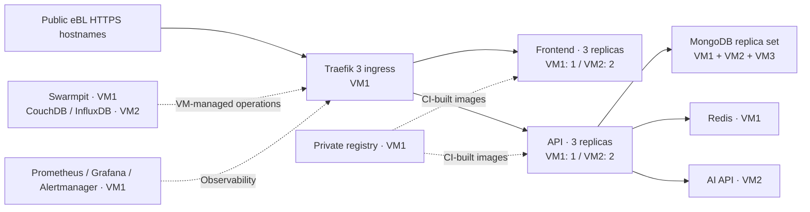

# Electronic Babylonian Library — Infrastructure Documentation

This public repository documents the operations and architecture of the **Electronic Babylonian Library (eBL)** at the Leibniz Supercomputing Centre (LRZ). The running infrastructure is a three-VM Docker Swarm managed by authorized staff via the **VMs and Swarmpit**.

> [!IMPORTANT]
> **This is not a deployment repository.** The YAML, TOML, and JSON files under [`reference/`](reference/README.md) are dated, incomplete or historical examples — **not** the authoritative running service definitions. Never deploy them directly against production or commit live configuration values, credentials, access-control rules or private certificates.

## Documentation map

| Need | Canonical guide |
| --- | --- |
| First-time VM access, VPN, SSH and local aliases | [VM access](docs/vm-access.md) |
| Inspecting Swarm services and operating eBL through Swarmpit | [Day-to-day operations and handover](docs/day-to-day-operations.md) |
| Traefik 3 production routes, TLS monitoring and recovery | [Traefik 3 production runbook](docs/traefik3-production-runbook.md) |
| Time-stamped service layout and unresolved verification | [Production inventory — 19 November 2026](docs/production-inventory-2026-11-19.md) |
| Incident diagnostics and escalation | [Troubleshooting notes](docs/troubleshooting.md) |
| Original VM provisioning and old setup instructions | [Historical provisioning notes](docs/historical-provisioning.md) |
| Source manifests, alert rules and Docker daemon examples | [Reference index and status](reference/README.md) |

## Architecture

The verified snapshot on **19 November 2026** showed VM1 as the **sole Swarm manager and public ingress**, VM2 and VM3 as workers, and a three-member MongoDB replica set with one member on each VM. API and frontend replicas happened to run **one on VM1 and two on VM2**; placement can change and is not guaranteed by the replica count.

The active sinkhole was present on VM2, but its effectiveness behind Traefik 3 was **not** established by the inventory. The legacy Traefik 1.7 proxy remains stopped at zero replicas as a controlled emergency fallback. Full service detail and evidence limits are recorded in the [dated inventory](docs/production-inventory-2026-11-19.md).

## Critical eBL deployment procedure

**For updated application images:** open [Swarmpit](https://www.ebl.badw.de/cluster/swarmpit/) → **Stacks → eBL → dropdown arrow next to Edit → Redeploy**.

**For authorized stack configuration changes:** **Stacks → eBL → Edit → Last Deployed → make reviewed changes → Deploy**.

> [!CAUTION]
> **Never deploy eBL from `Current Engine`.** Its re-serialized configuration can break the stack. If `Last Deployed` is unavailable, **stop** and involve the infrastructure maintainer. The complete, canonical workflow, required review and post-deploy checks are in [day-to-day operations](docs/day-to-day-operations.md#deploying-ebl-through-swarmpit).

## Operations and safety

- **Access:** [BAdW VPN and individually authorized SSH accounts](docs/vm-access.md). VM1 is the only manager; do not treat a worker's local container listing as a cluster inventory.
- **Backups:** LRZ VM backup coverage was **confirmed by the eBL operator** in November 2026; the recorded schedule is six snapshots daily with a 14-day retention. This audit did not establish successful restoration or MongoDB-consistent recovery. See [operations and recovery](docs/day-to-day-operations.md#backups-and-recovery).
- **Monitoring:** Prometheus, Grafana, exporters and certificate alerts are documented; live scrape success, notification delivery and database replica-set health require separate authorized checks.
- **Networking:** Published MongoDB and registry ports and the Docker metrics listener were observed. Their external reachability and the LRZ perimeter firewall rules were **not verified**; do not claim exposure or safety from publication alone.
- **References:** The [sample manifests](reference/README.md) intentionally preserve historical information. Do not infer that a reference equals the current VM/Swarmpit configuration.

## License and maintenance

This repository retains the project's [MIT license](LICENSE). Documentation is dated where appropriate; maintainers should update the operational guides after verified infrastructure changes, record what was observed versus inferred, and keep secrets and raw production evidence out of Git.
