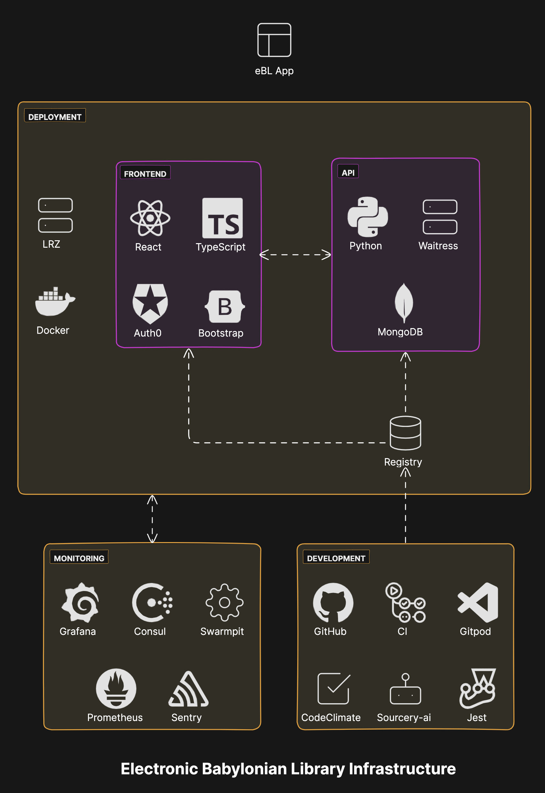
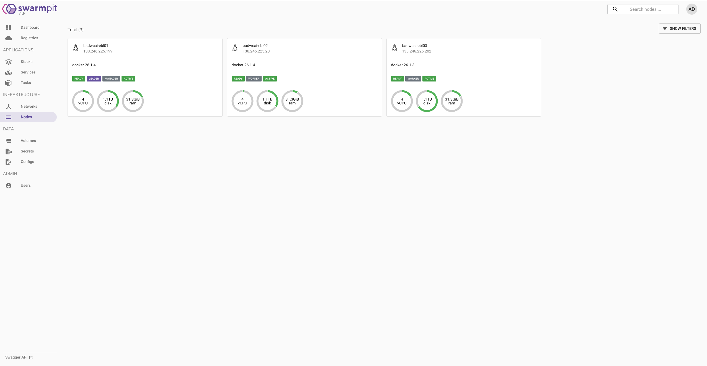
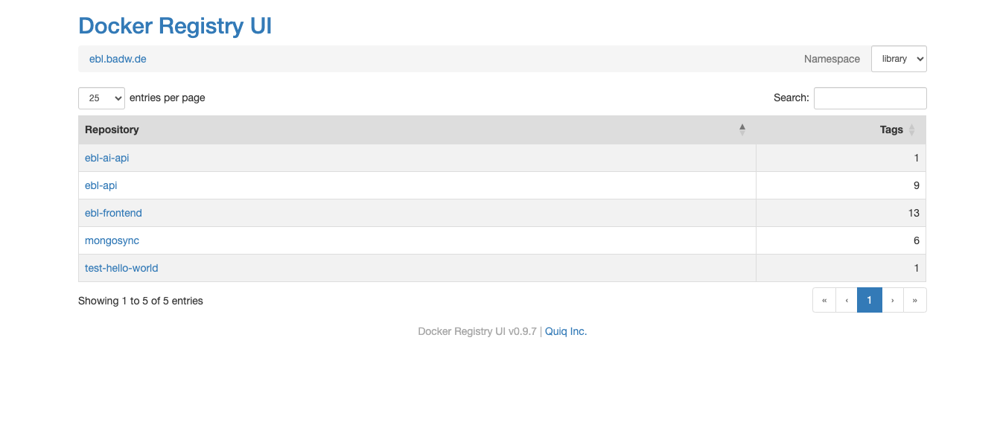
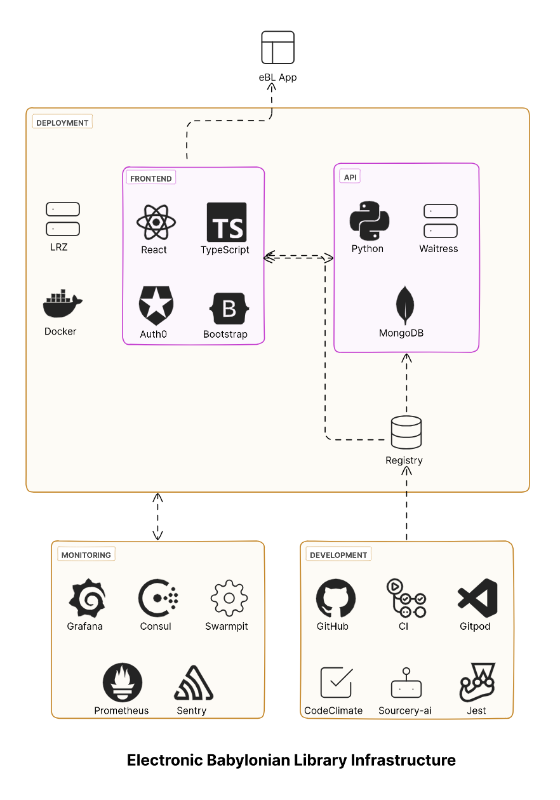

<p><a target="_blank" href="https://app.eraser.io/workspace/aGds6s7Uqq35ZqoSOch1" id="edit-in-eraser-github-link"></a></p>

# Electronic Babylonian Library Infrastructure
This repository describes the architecture of the Electronic Babylonian Library, a Dockerized cuneiform editing platform hosted on three VMs at the [Leibniz Supercomputing Centre (Leibniz Rechenzentrum, LRZ)](https://www.lrz.de/english/) of the [Bavarian Academy of Sciences and Humanities (Bayerische Akademie der Wissenschaften, BAdW)](https://badw.de/en/the-academy.html).

> [!IMPORTANT]
> **Traefik 3 is the production reverse proxy.** The legacy Traefik 1.7 service is retained at zero replicas as an emergency fallback. Use the [Traefik 3 operations guide](docs/traefik3-production-runbook.md) for deployment prerequisites, TLS, monitoring, verification, and rollback. Do not deploy the legacy reverse proxy alongside Traefik 3 on ports 80/443.

## Table of Contents
- [Table of Contents](#table-of-contents) 
- [1. General Architecture](#1-general-architecture) 
- [2. Monitoring and Maintenance](#2-monitoring-and-maintenance)
    - [Accessing the production VMs over SSH](#accessing-the-production-vms-over-ssh) 
- [3. Backup copies](#3-backup-copies) 
- [4. Setup](#4-setup) 
    - [4.1. Ordering VMs and DNS setup](#41-ordering-vms-and-dns-setup) 
    - [4.2. Preparations](#42-preparations) 
        - [4.2.1. Set up users](#421-set-up-users) 
        - [4.2.2. Set up ssh keys](#422-set-up-ssh-keys) 
        - [4.2.3. Install Docker](#423-install-docker) 
        - [4.2.4. Set up the firewall](#424-set-up-the-firewall) 
        - [4.2.5. Add image pruning](#425-add-image-pruning) 
        - [4.2.6. Disable internal sum checking](#426-disable-internal-sum-checking) 
    - [4.3. Docker Swarm Setup](#43-docker-swarm-setup) 
        - [4.3.1. Initialize the swarm](#431-initialize-the-swarm) 
        - [4.3.2. Optional: Test Swarmpit](#432-optional-test-swarmpit) 
    - [4.4. SSL Certificates](#44-ssl-certificates) 
    - [4.5. HTTPS and Monitoring](#45-https-and-monitoring) 
        - [4.5.1. Traefik and Consul](#451-traefik-and-consul) 
        - [4.5.2. Swarmpit](#452-swarmpit) 
        - [4.5.3. Swarmprom](#453-swarmprom) 
    - [4.6. MongoDB initialization](#46-mongodb-initialization) 
    - [4.7. Replica set](#47-replica-set) 
    - [4.8. Monitoring](#48-monitoring) 
    - [4.9. Docker registry](#49-docker-registry) 
    - [4.10. eBL application](#410-ebl-application) 
    - [4.11. Mongosync](#411-mongosync) 
    - [4.12. Sitemap](#412-sitemap)
- [5. Troubleshooting](#5-troubleshooting) 
    - [5.1. Consul fails to elect a leader](#51-consul-fails-to-elect-a-leader) 
    - [5.2. Redeployment fails in Swarmpit UI](#52-redeployment-fails-in-swarmpit-ui) 
    - [5.3. Forgotten Grafana password](#53-forgotten-grafana-password) 
    - [5.4. "invalid memory address or nil pointer dereference" from mongodb_exporter](#54-invalid-memory-address-or-nil-pointer-dereference-from-mongodb_exporter) 
    - [5.5. The cluster becomes unresponsive](#55-the-cluster-becomes-unresponsive) 
    - [5.6. Low diskspace](#56-low-diskspace) 
    - [5.7. Expired or invalid HTTPS certificate](#57-expired-or-invalid-https-certificate) 
## 1. General Architecture
The system consists of a Docker Swarm distributed over three Debian VMs. The web app is built in React/TypeScript and communicates with a Python backend and a MongoDB database. When a PR is merged into the master branch of the ebl-api or ebl-frontend repositories, a new Docker image is built and pushed to our own private Docker registry. The next time the ebl-stack is re-deployed (either via the commandline or the Swarmpit UI), the new image is pulled and goes live.

Each component runs as one or more Docker Swarm services, generally defined by a stack YAML file with external configuration objects and Docker secrets. Operators normally manage the swarm from the manager node. The frontend and backend run multiple application replicas; Swarm can reschedule eligible tasks when a node fails, subject to placement constraints and service dependencies.

**Public ingress is a separate availability constraint:** production Traefik 3 runs as one replica pinned to `badwcai-ebl01`, with host-mode ports 80/443. If that node fails, replicas of the frontend and API on other nodes do not by themselves preserve public access.

MongoDB uses a three-member replica set across the VMs. The primary handles writes; reads normally use the primary unless an application explicitly requests a secondary read preference. An eligible secondary can become primary after an election if the replica set retains a majority. Swarm scheduling and MongoDB elections are separate mechanisms.

Networking is handled by Traefik, a reverse proxy that allows our Docker services to talk to each other and to become accessible from outside the server.




## 2. Monitoring and Maintenance
Monitoring and basic maintenance is primarily done via [Swarmpit](https://swarmpit.io/). Our instance is accessible at [https://www.ebl.lmu.de/cluster/swarmpit/](https://www.ebl.lmu.de/cluster/swarmpit/) and allows you to check the system status, view logs, and (re-)deploy services.



### Accessing the production VMs over SSH

For host-level administration (Docker, filesystem, networking or recovery), use an **approved personal VM account** and connect to the **BAdW full-tunnel VPN** before SSH. This VPN is also required for access from networks where the VMs are otherwise unreachable; the original deployment required it even on the academy network. Do not rely on the public eBL website URL for SSH access.

| SSH alias | VM hostname | IP address | Role |
| --- | --- | --- | --- |
| `caic1` | `badwcai-ebl01` | `138.246.225.199` | Docker Swarm manager / production ingress |
| `caic2` | `badwcai-ebl02` | `138.246.225.201` | Swarm node |
| `caic3` | `badwcai-ebl03` | `138.246.225.202` | Swarm node |

From Windows PowerShell, macOS Terminal or a Linux shell, use OpenSSH. Substitute the username of your **existing authorized VM account**:

```sh
ssh <your-vm-username>@138.246.225.199
ssh <your-vm-username>@138.246.225.201
ssh <your-vm-username>@138.246.225.202
```

**Name resolution:** The short hostname `badwcai-ebl01` may not resolve on a Windows workstation (`Could not resolve hostname`). Use the IP above or a locally configured SSH alias instead. The full internal DNS names are `badwcai-ebl01.srv.mwn.de`, `badwcai-ebl02.srv.mwn.de` and `badwcai-ebl03.srv.mwn.de`, but do not assume your workstation's DNS can resolve them. The IP-based connection to VM1 was verified from Windows during the Traefik migration. Confirm changes to VM addresses with the system administrators rather than guessing.

For a one-line file transfer from **Windows PowerShell**:

```powershell
scp "$env:USERPROFILE\Downloads\example.txt" "<your-vm-username>@138.246.225.199:/home/<your-vm-username>/"
```

Use a single line in PowerShell; a trailing Linux-style backslash is **not** a PowerShell continuation character. When a transfer fails, first confirm that SSH works with the same VPN connection, destination IP and account. Use an SSH key where authorized and do not share private keys or account passwords. The optional `caic1`/`caic2`/`caic3` aliases are documented in [SSH key setup](#422-set-up-ssh-keys).

Additional information and statistics about the system are displayed in our Grafana instance [here](https://www.ebl.badw.de/cluster/grafana/). Traefik also comes with a UI that can be accessed at [https://www.ebl.badw.de/cluster/traefik/](https://www.ebl.badw.de/cluster/traefik/). Our private Docker registry has a basic UI, too.

## 3. Backup copies
6 daily backup images of the servers are made, at 02:20, 06:20, 10:20, 14:20, 18:20 and 22:20 hrs. The images are kept for 14 days. The images
can be restored by the LRZ on short notice by opening a ticket on their [Service Desk](https://servicedesk.lrz.de/). If it is necessary to
restore a backup copy, the images of all nodes of the Replica Set should be restored, not just one of the nodes, as otherwise they will be out
of sync.

## 4. Setup
Knowledge about server infrastructure and Docker concepts (containers, images, networks, configs, secrets, etc.) is necessary.

The following setup history describes the system after the July 2024 VM migration. Some provisioning instructions are historical and must not be used as routine maintenance procedures. Follow the [current production SSH access procedure](#accessing-the-production-vms-over-ssh) for existing machines and the [Traefik 3 operations guide](docs/traefik3-production-runbook.md) for ingress changes. Review the live Swarm configuration before redeployment, and keep repository manifests synchronized with authorized infrastructure changes. Command syntax can differ between Unix shells and Windows PowerShell; platform-specific examples are labeled.

### 4.1. Ordering VMs and DNS setup
The VMs were provisioned through [LRZ VM management](https://vm.lrz.de/). **This paragraph concerns initial VM provisioning, not routine access to existing production machines.** For a newly issued VM, LRZ provides the initial account and access details through its approved channel; change any temporary credentials according to institutional policy and store them securely. For existing eBL VMs, use the [production SSH access procedure](#accessing-the-production-vms-over-ssh) and your personal authorized account. Do not try the original provisioning credentials or create a new account simply to perform normal maintenance.

Masterusers can request configuration changes (like RAM or storage upgrades) by opening a ticket at the [Service Desk](https://servicedesk.lrz.de/).

Public eBL DNS is managed by the responsible LMU and BAdW hostmasters (see [Vergabe neuer Sub-Domains](https://doku.lrz.de/verwendung-eigener-domainnamen-10745829.html)). The four production HTTPS hostnames are [www.ebl.badw.de](https://www.ebl.badw.de/), [ebl.badw.de](https://ebl.badw.de/), [www.ebl.lmu.de](https://www.ebl.lmu.de/), and [www.ebl.uni-muenchen.de](https://www.ebl.uni-muenchen.de/). All four were verified during the Traefik 3 cutover. Coordinate future DNS changes with the domain administrators.

### 4.2. Preparations
The setup steps must be performed **on each VM individually**.
For most of the commands you will need `sudo`, but once Docker is set up and running the `docker` commands don't require it.

#### 4.2.1. Set up users
**Initial provisioning only:** Connect through the BAdW full-tunnel VPN and use the temporary administrator credentials supplied for a newly provisioned VM by LRZ. For existing production machines, follow [production SSH access](#accessing-the-production-vms-over-ssh) with your approved personal account instead. Creating users or changing access permissions on an existing VM requires administrator authorization.

For a new VM, create appropriately authorized administrator users according to institutional policy. The historical setup included a shared `ebladmin` account and used the following group commands:

```sh
adduser ebladmin
usermod -aG sudo ebladmin
usermod -aG ssh-login ebladmin
```
You can then switch to the new user with `su ebladmin`.

#### 4.2.2. Set up ssh keys
**Recommended for authorized VM accounts:** Set up SSH public-key authentication instead of repeatedly entering a password. Never copy the private key to the server or commit it to this repository. Your SSH key and account must be authorized for each VM you access.

On Windows, edit `$env:USERPROFILE\.ssh\config` (the OpenSSH config file); on macOS/Linux, edit `~/.ssh/config`. Add the optional aliases below, replacing `your_vm_username` with your personal VM account. Use `IdentityFile ~/.ssh/id_ed25519` (or your actual private-key file) if the identity is not selected automatically. The aliases are local shortcuts; the IP addresses do not depend on short-hostname resolution.

```sh
# CAIC eBL VM1
Host caic1
  HostName 138.246.225.199
  Port 22
  User your_vm_username

# CAIC eBL VM2
Host caic2
  HostName 138.246.225.201
  Port 22
  User your_vm_username

# CAIC eBL VM3
Host caic3
  HostName 138.246.225.202
  Port 22
  User your_vm_username
```
**On each VM (with approval):** Add only the **public** SSH key (for example, the contents of `~/.ssh/id_ed25519.pub`) to your own account's `~/.ssh/authorized_keys`. Restrict the `~/.ssh` directory to mode `0700` and `authorized_keys` to `0600`. Never overwrite other administrators' existing authorized keys or add keys to a shared account without approval.

Reconnect with `ssh caic1`, `ssh caic2` or `ssh caic3` while the BAdW VPN is connected. Visual Studio Code Remote SSH can use the same local OpenSSH aliases. If the short hostname fails, use the IP-backed alias or the explicit IP-based command shown above.

#### 4.2.3. Install Docker
- [Install Docker Engine - Community from Docker's repositories](https://docs.docker.com/install/linux/docker-ce/debian/#install-using-the-repository) 
(current version: `Docker version 26.1.4, build 5650f9b` )
- Follow the [Docker post-installation steps](https://docs.docker.com/engine/install/linux-postinstall/) only when provisioning a **new VM**; do not reinstall or restart Docker on an existing production VM as routine maintenance.
- The `docker` Unix group grants **root-equivalent privileges**. Only authorized administrators should be added; avoid treating it as a harmless convenience.
- The repository's [daemon.json](daemon.json) contains logging and metrics settings. Inspect `/etc/docker/daemon.json` and **merge** settings with the existing JSON; do **not** append another JSON object using `>>`. An invalid daemon configuration can prevent Docker from starting.
- Validate the candidate settings with `sudo dockerd --validate --config-file=/etc/docker/daemon.json` (or a temporary candidate path) before an **authorized** Docker restart. Restarting the daemon may disrupt Swarm tasks and must be coordinated as a separate maintenance operation.
- `sudo systemctl status docker` checks daemon state without changing it.

#### 4.2.4. Set up the firewall
Certain ports need to be opened for Docker to be able to communicate between the VMs. Docker additionally opens up ports via iptables that don't show up in the ufw rules
and that don't need to be configured separately.

For each VM, you need to allow traffic to the other two VMs. For the first VM, run the commands below with the IPs of the 2nd and 3rd VM. Adapt accordingly for the other VMs.

```sh
sudo ufw allow proto tcp from <VM2 IP> to any port 2377,7946 comment 'Docker Swarm'
sudo ufw allow proto udp from <VM2 IP> to any port 7946,4789 comment 'Docker Swarm'

sudo ufw allow proto tcp from <VM3 IP> to any port 2377,7946 comment 'Docker Swarm'
sudo ufw allow proto udp from <VM3 IP> to any port 7946,4789 comment 'Docker Swarm'
```
Additionally, the following port must be opened for metrics. This command is identical on all three VMs:

```sh
sudo ufw allow from 172.18.0.0/16 to any port 9323 comment 'Docker Metrics'
```
#### 4.2.5. Add image pruning
Unused images may consume disk space. The following historical cron example removes **dangling** images older than 24 hours; it does not remove volumes or all unused tagged images. Review disk usage and existing scheduled tasks before installing or modifying a pruning job. The example cron entry is:

```sh
0 4 * * * docker image prune -f --filter "until=24h" 2>&1 | /usr/bin/logger -t docker-pruning
```
The cron entry runs at 04:00 and logs as `docker-pruning`. Without `--all`, `docker image prune` removes only dangling images matching the age filter. It does not prune Docker volumes. Do not assume this schedule is installed on every node without checking the actual crontab.

#### 4.2.6. Disable internal sum checking
On Debian 12, Docker Swarm can sometimes fail due to issues with internal sum
checking. What happens is that after setting up the swarm, it is partially functional
(it can ping but cannot transfer any data). In Swarmpit the nodes show up but remain
in a "Loading..." state indefinitely. If such symptoms occur, you need to disable
internal sum checking with:

```sh
ethtool -K ens192 tx-checksum-ip-generic off
```
See [here](https://github.com/swarmpit/swarmpit/issues/688) for more details.

### 4.3. Docker Swarm Setup
For setting up the infrastructure you need the different YAML and other configuration files from this repository.
It is recommended to download all of it onto the first VM. The following commands will assume you did so from your user directory
(e.g., `cd ~ && git clone https://github.com/ElectronicBabylonianLiterature/infrastructure.git`).

#### 4.3.1. Initialize the swarm
On the first VM, [create a new swarm](https://docs.docker.com/engine/swarm/swarm-tutorial/create-swarm/). This turns
the first VM into the manager node of the swarm. It will output a command for joining the swarm which has to be run on
each of the two other VMs which will make them worker nodes. If you need to display the join command again, run
`docker swarm join-token worker` on the manager. Check the status of the swarm by running the command below on the manager node:

```sh
$ docker node ls
ID                            HOSTNAME        STATUS    AVAILABILITY   MANAGER STATUS   ENGINE VERSION
z2hbdfjkyqn3z1b8kmndm7exp *   badwcai-ebl01   Ready     Active         Leader           26.1.4
3bzj3ocpoqy1vvm07l56n7ef0     badwcai-ebl02   Ready     Active                          26.1.4
k5vo2xli9y8b4q9jcirx6byll     badwcai-ebl03   Ready     Active                          26.1.4
```
Unless specified otherwise, the commands below have to be run (only) on the manager node, i.e., the first VM caic1/badwcai-ebl01.

#### 4.3.2. Optional: Test Swarmpit

**Historical setup note:** The previous standalone Swarmpit installer and port-888 instructions are not the access or upgrade procedure for the existing eBL cluster. Swarmpit is already deployed as the `swarmpit` Swarm stack behind Traefik 3 at [https://www.ebl.badw.de/cluster/swarmpit/](https://www.ebl.badw.de/cluster/swarmpit/).

Use your approved administrative account to inspect running services. Before any stack redeployment, reconcile the live service specification with the repository files; see [Swarmpit deployment](#452-swarmpit) and the [Traefik 3 operations guide](docs/traefik3-production-runbook.md). Do not run the old installer against production simply to troubleshoot access.

### 4.4. SSL Certificates

**MongoDB internal TLS — new-cluster provisioning or authorized certificate rotation only.** These certificates secure the MongoDB replica set and are separate from the public HTTPS certificates managed automatically by Traefik 3.

The active [MongoDB replica-set manifest](mongodb-replica_set.yml) references the Docker secrets `mongoCA.crt`, `ebl01.pem`, `ebl02.pem` and `ebl03.pem`. Individual certificate/key files are mounted in the corresponding MongoDB containers; replica members and clients must trust the CA certificate.

For a **new cluster** or approved renewal, follow the institution's private CA/key-management procedure. MongoDB server certificates must contain the correct DNS **Subject Alternative Names (SANs)** for the respective node hostnames, including `badwcai-ebl01.srv.mwn.de`, `badwcai-ebl02.srv.mwn.de` and `badwcai-ebl03.srv.mwn.de` where applicable. Do not rely solely on the certificate Common Name for hostname verification, and preserve the required x.509 member-authentication properties.

Inspect each certificate privately before use, for example:

~~~sh
openssl x509 -in ebl01.crt -noout -subject -issuer -dates -ext subjectAltName
~~~

Protect the CA key and avoid printing private key material. Coordinate certificate rotation and any MongoDB member restarts using an approved procedure and rollback plan. **Do not regenerate the production CA, overwrite live Docker secrets or redeploy the populated database based on historical bootstrap commands.**

### 4.5. HTTPS and Monitoring
We use a setup based on the (now deprecated) [Docker Swarm Rocks](https://dockerswarm.rocks/).

#### 4.5.1. Traefik and Consul

Public traffic enters eBL through **Traefik 3.7.18**, managed by Docker Swarm. The production service is `traefik3parity_proxy` in the `traefik3parity` stack and listens on host ports 80 (HTTP and ACME HTTP-01) and 443 (HTTPS). It routes requests over the `traefik-public` overlay network to the application and administration services.

The ingress service runs as one replica on the designated ingress node because host-mode ports cannot be published by multiple tasks on that node. The frontend and API have separate application replicas. For the current stack definition, see [traefik3-production.yml](traefik3-production.yml); for operating procedures, see the [Traefik 3 operations guide](docs/traefik3-production-runbook.md).

**TLS:** Traefik uses Let's Encrypt ACME, with persistent certificate storage on the ingress node. Certificates and account keys must be kept in restricted persistent storage and backed up securely; neither the ACME JSON file nor Docker secret material belongs in Git.

**Deployment:** The production stack refers to versioned external Docker Swarm configs. Before any redeployment, verify that those configs and secrets exist, review the actual running service specification, and follow the deployment checks in the operations guide. Do not run `docker stack deploy` from this repository without completing those checks.

**Legacy support:** The `traefik-consul_traefik` service remains stopped at zero replicas for emergency rollback; its published port definitions remain in its service specification. The Consul leader is a separate service and remains available as required by legacy components. Do not scale up the old reverse proxy while Traefik 3 owns ports 80 and 443.

#### 4.5.2. Swarmpit
See: [Swarmpit web user interface for your Docker Swarm cluster](https://dockerswarm.rocks/swarmpit/).

The swarmpit stack does not require any prior set up and can be directly deployed with:

```sh
docker stack deploy -c swarmpit.yml swarmpit
```
The UI should now be accessible at [https://www.ebl.badw.de/cluster/swarmpit/](https://www.ebl.badw.de/cluster/swarmpit/).

#### 4.5.3. Swarmprom

[Swarmprom](https://github.com/stefanprodan/swarmprom) provides Prometheus metrics, Grafana dashboards and Alertmanager alerting. The existing monitoring deployment is the `swarmprom` Swarm stack.

The [swarmprom.yml](swarmprom.yml) manifest includes the production `traefik3parity_proxy:9100` scrape target and preserves the legacy `traefik:8080` target during the rollback period. The installed combined task rules use the immutable external config `task_rules_tls3_20261113T213540Z`. The [standalone TLS alert definitions](prometheus/traefik3-certificate-alerts.yml) are **not** a replacement for the complete rule file.

**Private deployment inputs:** Never put passwords, Slack webhooks or MongoDB connection credentials directly into a commit. The monitoring manifest requires `EBL_ALERTMANAGER_SLACK_URL`, `EBL_GRAFANA_ADMIN_PASSWORD` and `EBL_MONGODB_EXPORTER_URI`, supplied from an approved restricted credential store. Review the **whole rendered stack** against the running services before any redeployment. Do not deploy placeholder values, replace live service settings with historical defaults, or redeploy the entire stack just to change one alert rule.

See the [Traefik 3 operations guide](docs/traefik3-production-runbook.md) for metrics, certificate renewal alerts, validation and rollback. A healthy Alertmanager connection does not on its own prove notification delivery.

The Grafana UI is at [https://www.ebl.badw.de/cluster/grafana/](https://www.ebl.badw.de/cluster/grafana/).

Import the [Traefik dashboard](https://grafana.com/grafana/dashboards/4475) to Grafana.

### 4.6. MongoDB initialization

**Fresh-cluster provisioning only — not a production maintenance procedure.** The historical [mongodb.yml](mongodb.yml) defines a non-TLS bootstrap used before the TLS-protected [mongodb-replica_set.yml](mongodb-replica_set.yml) was deployed. The existing production cluster is populated and already uses a replica set.

For a brand-new, empty environment, obtain an approved provisioning plan covering MongoDB administrator Docker secrets, certificate lifecycle, node placement and persistent volumes, and the sequence for creating replica-set membership. Do not reuse historical bootstrap credentials or overwrite production secrets.

**Never deploy the non-TLS bootstrap stack against the existing production database or treat database reinitialization as a repair operation.** Consult the diagnostic guidance below and an approved recovery plan instead.

### 4.7. Replica set

The [MongoDB replica-set manifest](mongodb-replica_set.yml) defines three MongoDB 7 services on the three designated VMs, replica-set name `rs-ebl`, and TLS/x.509 member authentication. The host-facing ports are 27017, 27018 and 27019, respectively.

For **existing production**, begin with read-only service inspection on the Swarm manager:

~~~sh
docker service ls --filter name=ebl-mongodb
docker service ps ebl-mongodb_mongo1
docker service ps ebl-mongodb_mongo2
docker service ps ebl-mongodb_mongo3
~~~

Use `mongosh` with an authorized MongoDB account, trusted CA and the appropriate authentication database. For example, **inside an approved MongoDB container where the CA secret is mounted**:

~~~sh
mongosh --host badwcai-ebl01.srv.mwn.de:27017 --tls --tlsCAFile /run/secrets/mongoCA.crt --username <approved-user> --authenticationDatabase admin
~~~

After authentication, inspect `rs.status()` and `db.hello()`. These diagnostic commands do not modify replica-set membership. Avoid `--tlsAllowInvalidCertificates` in routine administration.

**New empty cluster only:** A replica-set administrator initializes membership once using `rs.initiate()` and verified member addresses. **Never call `rs.initiate()` again on an existing production set.**

For TLS or election failures, first examine logs, certificate chains/SANs/expiration, DNS, network connectivity, and replica-set quorum. **Do not redeploy the non-TLS bootstrap, delete the MongoDB or monitoring stacks, remove Docker secrets, or regenerate the CA as a troubleshooting shortcut.** Those operations require a separately approved recovery plan.

### 4.8. Monitoring

The MongoDB exporter is deployed through Swarmprom as `percona/mongodb_exporter:0.37.0`. The Prometheus job scrapes the exporter on port `9216`. When metrics are missing, verify exporter service health and logs, its MongoDB/TLS connectivity and the actual Prometheus target errors.

The dedicated MongoDB exporter account requires monitoring permissions. Historical provisioning used `clusterMonitor` on `admin` and read access to `local`. These are **not instructions to recreate production users**. Preserve the current approved credentials and reference them through the private `EBL_MONGODB_EXPORTER_URI` deployment input; do not paste them into `swarmprom.yml`.

You can now import the [MongoDB dashboard](https://grafana.com/grafana/dashboards/2583) to Grafana. In Grafana, edit the dashboard JSON and change the metric
prefix from `mongodb_` to `mongodb_mongod_`.

### 4.9. Docker registry


The private Docker registry is were the eBL api and frontend apps will be pushed by GitHub CI and then pulled by our stacks when being redeployed after updates.
It requires a separate set of credentials and configs.

**For the configurations:** [Generate a UUID](https://www.uuidgenerator.net/) and replace the `Bearer`/`event_listener_token` placeholders in the registry_config.yml
and docker-registry-ui_config.yml. It just has to be something difficult to guess that matches between the two configuration files. Create the configs with:

```sh
docker config create registry_config ~/infrastructure/registry_config.yml
docker config create docker-registry-ui_config ~/infrastructure/docker-registry-ui_config.yml
```
**For the secrets:** Similar to `basic_auth_users` above, create a file `registry_htpasswd` by running `htpasswd -Bn admin > registry_htpasswd`
and entering a new password. We also need a `github` user that is used by GitHub CI to authenticate when pushing to the registry.
The credentials must match the secrets set up in GitHub and passed to the CI YAML both in the ebl-api, ebl-frontend, and the ebl-ai-api.
This time, run `htpasswd -Bn github` and append the output to the `registry_htpasswd` file so it has two sets of credentials, one per line.

The admin password also needs to be stored as clear-text secret, so paste the password into a file `docker-registry-ui_admin_password`.

Now, create the secrets:

```sh
docker secret create docker-registry-ui_admin_password ./docker-registry-ui_admin_password
docker secret create registry_htpasswd ./registry_htpasswd
```
And deploy the registry stack:

```sh
docker stack deploy -c ~/infrastructure/registry.yml registry
```
The registry comes with a basic UI that should now be accessible at [https://www.ebl.badw.de/cluster/registry-ui/](https://www.ebl.badw.de/cluster/registry-ui/) (after login). If GitHub workflows
are set up to push to this registry, visit the ebl-api and ebl-frontend repos and manually trigger a CI run for each. The images should then be visible in the UI.

Before pulling from the registry it may be necessary to run `docker login ebl.badw.de` and logging in using the credentials we just set. Otherwise, Docker may
be unable to pull, showing `No such image`. It may even be necessary to login twice, once with and once without `sudo`, and on all VMs individually, and
pass the `--with-registry-auth` flag when `deploy`ing.

### 4.10. eBL application
In ebl.yml, replace the placeholders in `services.api.environment` with the real keys/credentials, and deploy the stack:

```sh
docker stack deploy -c infrastructure/ebl.yml ebl --with-registry-auth
```
If it fails with `No such image`, make sure the image is in the registry and be sure to `docker login` as described above. If it fails with another error (`Non-zero exit`),
it means the container was successfully pulled but the app failed to start for some other reason, e.g., incorrect environment variables or a wrong command.

Note that the environment variables for the frontend are configured in [GitHub actions](https://github.com/ElectronicBabylonianLiterature/ebl-frontend/blob/master/.github/workflows/main.yml)
and passed to the Docker image from there.

The `ai-api` service is part of the currently deployed eBL application and was running in the last verified Swarm inventory. Do not disable it without checking `EBL_AI_API` and application dependencies. The [ebl-ai-api repository](https://github.com/ElectronicBabylonianLiterature/ebl-ai-api) contains the AI service; the Redis exporter and Prometheus job support its monitoring.

**Before an application stack redeploy:** [ebl.yml](ebl.yml) still contains historical Traefik 1.7 routing/rate-limit labels. Traefik 3 currently uses its own dynamic file-provider configuration, so do not treat those labels as the authoritative production routing setup. Reconcile the live service with the manifest and the [Traefik 3 operations guide](docs/traefik3-production-runbook.md).

### 4.11. Mongosync
The script for populating the development db `ebldev` is developed in a dedicated repository at [https://github.com/ElectronicBabylonianLiterature/mongosync](https://github.com/ElectronicBabylonianLiterature/mongosync).
It requires `mongosync_user` and `mongosync_password` Docker secrets matching the credentials set up above (see section _Monitoring_). Download the
docker-compose.yml or clone the repository and run `docker stack deploy -c mongosync/docker-compose.yml mongosync`.

### 4.12 Sitemap
For the sitemap automated and manual update configuration, check the [Sitemap section](https://github.com/ElectronicBabylonianLiterature/ebl-frontend#sitemap) of the Frontend repository documentation.

## 5. Troubleshooting
### 5.1. Consul fails to elect a leader
- Scale replicas to 0.
- Scale replica back to desired value.
When the new replicas join Consul should clean up old nodes and elect a new leader. To avoid stale nodes in the config the replicas should be shut down before the leader.

### 5.2. Redeployment fails in Swarmpit UI
Long commands (e.g. `node-exporter`) get messed up and `$` is unescaped in the "Current engine state". If you have to redeploy a service/stack edit the "Last deployed" instead
or copy the correct values from the server.

### 5.3. Forgotten Grafana password
The Grafana admin password is set up only on first run. It can be resetted later vie the CLI `docker exec -ti <container id> grafana-cli admin reset-admin-password <new password>`.

### 5.4. MongoDB exporter errors

A historical Percona exporter issue was tracked under PMM-4375. Similar error messages today should not automatically be attributed to that issue. The deployed exporter is `percona/mongodb_exporter:0.37.0`. Before changing its image, collectors or credentials, inspect its logs, the replica-set connection/TLS state, and the Prometheus `mongodb-exporter:9216` target.

### 5.5. The cluster becomes unresponsive

**Diagnose before restarting Docker.** A daemon restart on a Swarm manager or MongoDB replica-set member can interrupt services and affect quorum. Restarting Docker on all VMs is not a safe blanket recovery step.

With manager SSH access, start with read-only checks:

~~~sh
docker node ls
docker service ls
docker service ps traefik3parity_proxy
docker service ps ebl_api
docker service ps ebl-mongodb_mongo1
~~~

Inspect the affected task logs, host resource usage, disk capacity, network connectivity and MongoDB replica-set state. Preserve diagnostic evidence and coordinate a targeted recovery plan before restarting any production process.

If SSH or console access is unavailable, or Swarm quorum is lost, contact the responsible LRZ/ITG administrators with the affected hosts, errors and last known healthy state.

### 5.6. Low diskspace
Diskspace can be freed by removing old Docker images etc. See: [https://stackoverflow.com/questions/32723111/how-to-remove-old-and-unused-docker-images/32723127#32723127](https://stackoverflow.com/questions/32723111/how-to-remove-old-and-unused-docker-images/32723127#32723127) 

### 5.7. Expired or invalid HTTPS certificate

Production certificates are issued and renewed by Traefik 3's Let's Encrypt ACME resolver, using persistent storage on the ingress node. The Prometheus certificate-expiration alert rules provide advance warning; an Alertmanager connection alone does not guarantee notification delivery.

When investigating a certificate problem:

1. Verify certificate trust and hostname coverage from an independent external client.
2. Check the `traefik3parity_proxy` service state, Traefik logs, and the Prometheus certificate-expiration metrics/alerts.
3. Confirm that the ACME storage directory is still mounted and writable by Traefik, and that HTTP port 80 remains reachable for HTTP-01 validation.
4. Follow the certificate recovery and rollback guidance in the [Traefik 3 operations guide](docs/traefik3-production-runbook.md).

**Do not restart the legacy Traefik 1.7 service as a certificate-renewal procedure.** That service is reserved for a controlled full-ingress rollback after the new proxy has relinquished ports 80/443.

<!-- eraser-additional-content -->
## Diagrams
<!-- eraser-additional-files -->
<a href="/README-Electronic Babylonian Library Infrastructure-1.eraserdiagram" data-element-id="UVNfbY_g6XF6ZtcWBPJcl"></a>
<!-- end-eraser-additional-files -->
<!-- end-eraser-additional-content -->
<!--- Eraser file: https://app.eraser.io/workspace/aGds6s7Uqq35ZqoSOch1 --->
